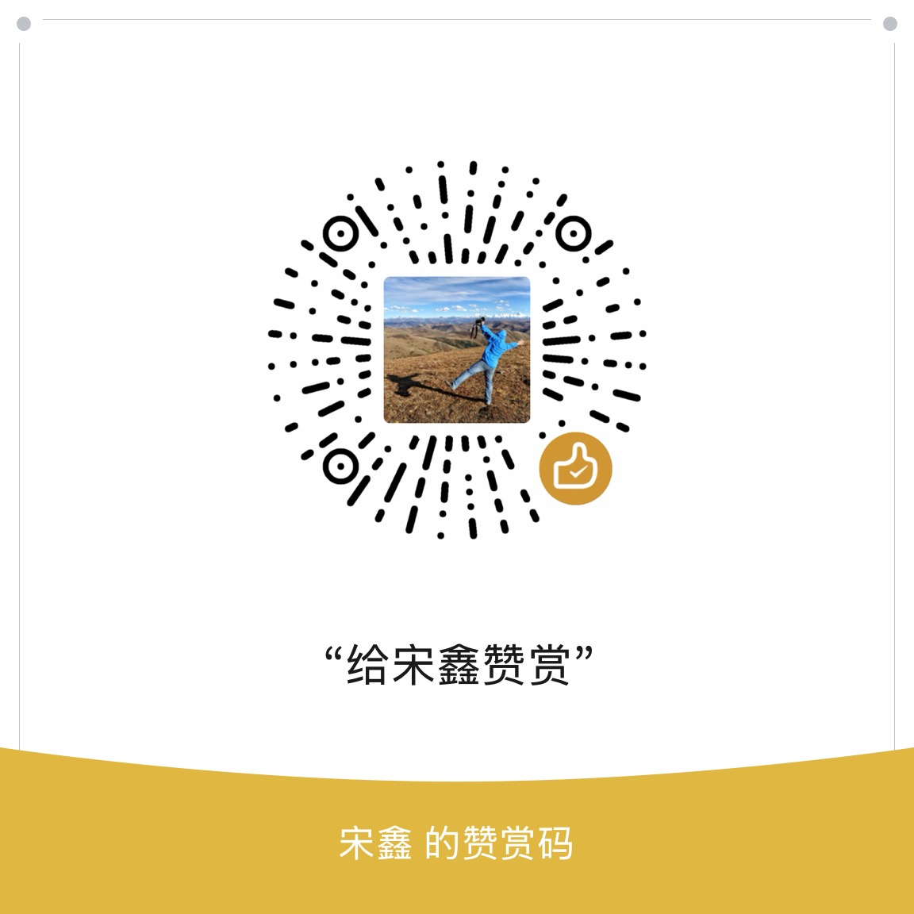

<div align="center">
  
  <h1>HaHa翻译</h1>
  <p><strong>让翻译留在你的 Mac。</strong></p>
  <p>Native, on-device translation for Apple Silicon Macs.</p>
  <p><strong>macOS 15+ · Apple Silicon</strong> · Swift · MIT</p>
  <p><a href="#功能">功能</a> · <a href="#从源码构建">构建</a> · <a href="CONTRIBUTING.md">参与改进</a> · <a href="#联系与支持">联系与支持</a></p>
</div>

---

我开发了 HaHa翻译，一款原生 macOS 翻译工具。下载模型后，文字翻译在本机完成；输入、剪贴板、选中文字和截图识别都能接入同一套工作流。

> **项目状态**：我于 2026 年 10 月 13 日停止本项目的 App Store 发布计划，并公开源码。当前仓库提供自行构建的方式，尚未发布经过 Developer ID 签名与公证的安装包。

## 功能

- 输入、粘贴或通过 macOS Services 翻译选中文字。
- 剪贴板快捷浮窗、复制并返回原应用。
- 区域截图、本机 Vision OCR 和翻译。
- 可配置双向语言、固定目标语言、术语表和默认关闭的本地历史。
- 两档 Hy-MT2 模型、固定文件校验、下载恢复和用户主动导入。
- 11 种界面语言及浅色、深色配色。

模型下载后，推理在 Mac 本机完成，不需要账户、API Key、Python、Ollama 或后台翻译服务器。模型下载会连接公开托管服务。截图功能需要相应系统权限。

## 从源码构建

要求 Apple Silicon、macOS 15+、完整 Xcode、XcodeGen 和 CMake。

```sh
brew install xcodegen cmake
bash Scripts/build-runtime.sh
bash Scripts/build-app.sh Debug
bash Scripts/test.sh
```

构建脚本从固定上游提交下载推理运行时源码并校验 SHA-256。生成的 XCFramework 和模型权重不提交到 Git。默认开发构建使用本地 ad hoc 签名；正式分发需要自己的 Developer ID 签名和公证。`project.yml` 的示例团队标识应替换为自己的配置，不能作为签名凭据使用。

模型首次使用由使用者主动下载或导入。应用内显示模型来源和许可证。源码构建不会自动下载模型权重。

## 实现

- `Sources/Core`：模型安装、来源选择、语言偏好、术语和文字处理。
- `Sources/Engine`：Swift actor 与流式本地推理。
- `Sources/UI`、`Sources/Platform`：SwiftUI、AppKit、系统服务、快捷键和 OCR。
- `Runtime`：固定版本运行时、C ABI、兼容补丁及上游许可证。
- `Tests`：核心单元测试。

运行时目前使用 CPU / ARM NEON，不宣称使用 Apple Neural Engine。详见 [运行时说明](Runtime/README.md)。

## 已知限制

翻译结果可能错误，速度和质量取决于设备、模型、语言和文本。开发验证不能代替专业译文审校。后台实体快捷键、授权后的完整截图流程及不同网络环境仍需要各自实测。首次模型下载需要网络和磁盘空间。

## 验证状态

核心测试共 70 项：69 项通过，1 项因未缓存官方模型样本跳过。11 种界面语言的键与占位符检查通过，原生 macOS 应用编译检查通过。

本地测试与编译结果不代表商店审核通过。模型下载后的实际译文质量、系统截图授权与全局快捷键，需要在自己的设备和使用场景中验证。

## 参与改进

欢迎提交问题、修复和体验改进。请先查看 [贡献指南](CONTRIBUTING.md)，在 Issues 中注明系统版本、复现步骤及预期行为。安全问题请通过 [安全反馈说明](SECURITY.md) 私下联系我，避免公开敏感信息。

## 许可证

我的原始应用源码按 [MIT 许可证](LICENSE) 开源。第三方运行时和模型保留各自的许可证，详见 [第三方声明](THIRD_PARTY_NOTICES.md)。仓库不包含模型权重。

## 联系与支持

我是宋鑫。如果你在使用或开发中有建议，欢迎通过 GitHub Issues 或 [sapplex@icloud.com](mailto:sapplex@icloud.com) 联系我，也可以扫描下方微信二维码。

如果这个项目对你有帮助，欢迎自愿赞赏，支持我继续做实用的小工具。

<table>
  <tr>
    <th align="center">微信联系</th>
    <th align="center">微信赞赏</th>
  </tr>
  <tr>
    <td align="center"></td>
    <td align="center"></td>
  </tr>
</table>
